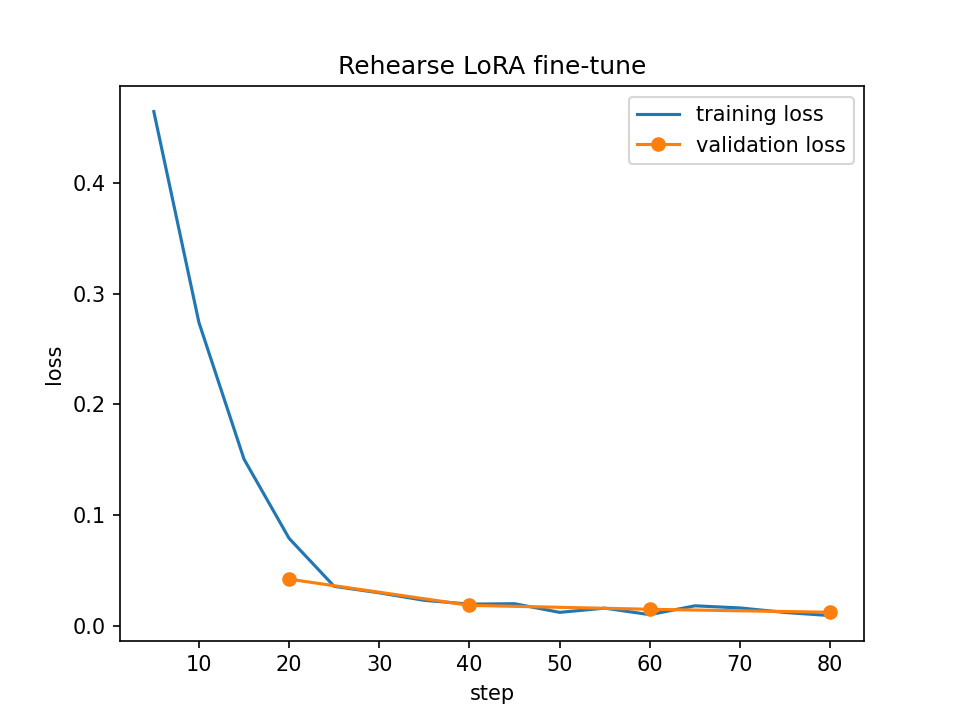

# Phase 9: Fine-tuning with LoRA

The third way Rehearse becomes app-specific: nudge the model's weights with our solved
HotelReservation examples (Phase 8), then measure whether the tuned model beats the base one.

## 1. The ideas

- **Fine-tuning** changes the model's weights a little, using examples of input → correct output.
- **LoRA** freezes the original 3 billion weights and trains small extra matrices beside some
  layers (rank `r` = 16 here, ~1% of the size). Cheap, and the original model stays untouched.
- **QLoRA** also keeps the frozen model in 4-bit, so it fits a free T4 GPU (15 GB) on Kaggle or Colab.
- **Loss** = how wrong the model is on examples. Training loss should fall. If validation loss
  (examples it does not train on) rises while training loss falls, it is **overfitting**
  (memorising): use fewer epochs or a smaller `r`.
- **GGUF / quantisation** = the compressed format Ollama runs on a laptop CPU (`q4_k_m`, ~1.9 GB,
  the same as `qwen2.5:3b`).
- **Same family and template:** we tune `Qwen2.5-3B-Instruct` (= the agent's `qwen2.5:3b`) and
  keep Qwen's chat template, so `rehearse` can send the same messages to both models.

## 2. What we built

| File | What |
|---|---|
| `ml/finetune/train.ipynb` | Notebook for Kaggle or Colab, detected automatically (Unsloth + QLoRA): loads `train.jsonl`/`val.jsonl`, renders the Qwen chat template, trains **only on the assistant answer** (`train_on_responses_only`), plots training and validation loss, checks one answer is valid JSON, saves the LoRA adapter and a merged `q4_k_m` GGUF. Every hyperparameter is explained in a markdown cell. Generated by `build_notebook.py` so diffs stay readable. |
| `ml/finetune/Modelfile` | `ollama create rehearse-hotel -f ml/finetune/Modelfile`: the GGUF with qwen2.5's exact template (including tool calling), `num_ctx 8192`, temperature 0. |
| `ml/eval/offline.py` | sends each `test.jsonl` input to one or more models and scores JSON validity, category, action, target, false alarms, tokens and latency on identical inputs. |
| `rehearse why --model rehearse-hotel` | the live harness can switch models: `make eval LABEL=tuned ARGS="--model rehearse-hotel"`. |

## 3. How to run it

1. On Kaggle (preferred: sessions are longer, and a saved run continues with the browser closed):
   - Create a **private** Dataset with `ml/datagen/data/train.jsonl` and `val.jsonl`.
   - Import `ml/finetune/train.ipynb` as a new notebook and attach the dataset with Add Input.
   - In Settings choose **GPU T4 x2** and **Internet on** (needs a verified phone number).
   - Save Version → **Save & Run All** (~20–40 min).

   On Colab instead: open the notebook, choose a **T4 GPU** runtime, run all, upload the two files.
2. Download `rehearse-hotel*.gguf` and `loss.png` (Kaggle: the version's Output tab); put the GGUF
   in `ml/finetune/outputs/` (git-ignored) and the plot in `docs/`.
3. On the laptop:

```bash
ollama create rehearse-hotel -f ml/finetune/Modelfile
ollama run rehearse-hotel                                         # quick check
ml/.venv/bin/python ml/eval/offline.py --models rehearse-base,rehearse-hotel
make eval LABEL=tuned ARGS="--no-rag --model rehearse-hotel"
make eval LABEL=tuned-rag ARGS="--model rehearse-hotel"
```

## 4. The 4-way comparison

| Setting | Model | RAG | How measured |
|---|---|---|---|
| base | rehearse-base | off | Phase 4 baseline (`results/baseline.csv`) |
| base + RAG | rehearse-base | on | Phase 5 (`results/rag.csv`) |
| tuned | rehearse-hotel | off | `results/tuned.csv` + `offline.py` |
| tuned + RAG | rehearse-hotel | on | `results/tuned-rag.csv` |

## 5. Results

Training ran on a Kaggle GPU on 318 training and 38 validation examples.



Training loss fell from about 0.46 to about 0.01, and validation loss fell and did not climb, so
the plot shows no overfitting. That is weaker evidence than it looks: the answers are templated and
validation has the same fault types as training, so a low loss mostly means it learned our format.

**Live test on the real cluster, HotelReservation, fully correct answers:**

| Setting | Fault runs | Fully correct | Share | False alarms | Avg s |
|---|---|---|---|---|---|
| base | 19 | 4 | 21% | 0/4 | 223 |
| base + RAG | 20 | 6 | 30% | 0/4 | 100 |
| **tuned** | 30 | **11** | **37%** | 1/6 | 205 |
| tuned + RAG | 30 | 5 | 17% | 0/6 | 239 |

Results by scenario (fully correct of runs). `db-auth-revoked` and `pod-failure` were held out of
training:

| Scenario | base | base + RAG | tuned | tuned + RAG |
|---|---|---|---|---|
| missing-configmap-key | 0/2 | 2/2 | 3/3 | 2/3 |
| replicas-zero | 1/2 | 2/2 | 3/3 | 2/3 |
| wrong-image | 1/2 | 2/2 | 3/3 | 1/3 |
| failing-readiness | 0/2 | 0/2 | 2/3 | 0/3 |
| oom-low-limit | 2/2 | 0/2 | 0/3 | 0/3 |
| wrong-targetport | 0/1 | 0/2 | 0/3 | 0/3 |
| network-delay | 0/2 | 0/2 | 0/3 | 0/3 |
| cpu-stress | 0/2 | 0/2 | 0/3 | 0/3 |
| db-auth-revoked (held out) | 0/2 | 0/2 | 0/3 | 0/3 |
| pod-failure (held out) | 0/2 | 0/2 | 0/3 | 0/3 |

**What this means, in plain words:**

- Fine-tuning helped on fault types it trained on. It scored 0 of 6 on the two held out, so this
  test does not show that it learned to handle new faults.
- Tuned with RAG was the worst setting. We did not investigate why. One possible reason is that the
  model learned to answer from facts in one format, and retrieved text changes that format.
- Tuned has the only false alarm, and it lost the OOM case that base got right.
- We kept `rehearse-base` with RAG as the default. Tuned has the higher share here, but the earlier
  full run of base with RAG scored 12 of 30 (40%), which is higher, so tuned has not clearly won.

**Limits of these numbers:**

- The base rows are incomplete. The final runs were stopped for time, so base has 2 full rounds
  (the second without one wrong-targetport run) and base + RAG has 2 rounds.
- Differences of a few runs are small evidence: the same base + RAG setting gave 40% in the earlier
  run and 30% here, on slightly different code.
- The machine was overloaded for part of the night, so the time column is not a fair speed test.
- The harness logged "NOT RESTORED" 4 to 5 times per setting: the app was not healthy again within
  the wait, and the next scenario started anyway. Some wrong answers could come from that.
- `ml/eval/offline.py` (the test on `test.jsonl`: JSON-valid rate, tokens) was **not run**, so there
  is no offline table.
